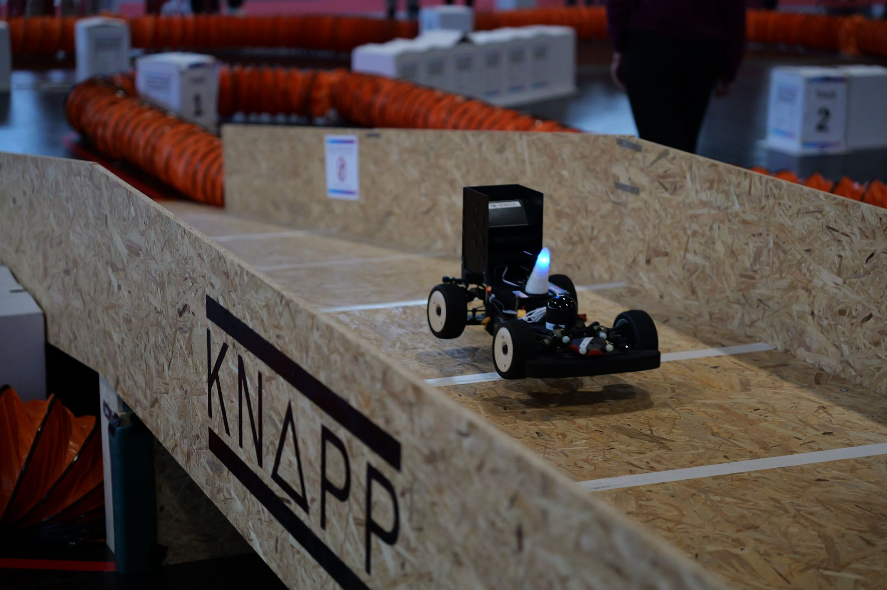

# UNICORN Racing Stack - ROS 1 Noetic (3D)

<p align="center">
  
</p>

<p align="center">
  
</p>

<p align="center">
  🏆&nbsp;&nbsp;<b>1st Place — <a href="https://icra2026-race.roboracer.ai/">ICRA&nbsp;2026 · 27th Roboracer Autonomous Racing Competition</a></b><br/>
  <sub>Team <a href="https://hmcl-unist.github.io/unicorn-racing/aboutus/">Unicorn Racing</a></sub>
</p>

This branch (`ros1_3d`) contains the 3D race stack of **Team Unicorn Racing**: localization on a 3D prior map, a 3D time-optimal racing line, and slope-aware velocity planning for tracks with slopes and bridges.

It extends our 2D stack from ICRA 2025 (2nd place, [race highlight](https://www.youtube.com/watch?v=Ukox0IPqGNA)), which is available on the [`ros1`](https://github.com/HMCL-UNIST/unicorn-racing-stack/tree/ros1) branch.

## Stack overview

| Module | Description |
|--------|-------------|
| State estimation | [GLIL](./state_estimation/GLIL_unicorn_racing) — LiDAR-inertial localization on a 3D prior map |
| Perception | opponent detection and tracking from an external package (`ra_imm`), enabled with `detection:=true` in `3d_base_system.launch` |
| Prediction | [gp_traj_predictor](./prediction/gp_traj_predictor/README.md) — Gaussian-process opponent trajectory prediction |
| Global planning | [3d_gb_optimizer](./planner/3d_gb_optimizer/README.md) — 3D track generation, time-optimal racing line, GGV diagrams |
| Local planning | [spliner](./planner/spliner/README.md), [sqp_planner](./planner/sqp_planner/README.md), [fast_sqp_planner](./planner/fast_sqp_planner/README.md), [recovery_spliner](./planner/recovery_spliner) |
| State machine | [state_machine](./state_machine/README.md) — racing / trailing / overtaking logic; optional FBGA speed profiles for the local waypoints in real time, on the same GGV |
| Control | [controller](./controller/README.md) — Pure Pursuit and MAP controllers |
| Tools | [stack_master](./stack_master/README.md) launch files, rqt plugins ([rqt_gg_viewer](./rqt_gg_viewer/README.md), [rqt_launch_control](./rqt_launch_control/README.md)), sector tuners in [f110_utils](./f110_utils) |

## Track preparation pipeline

Every new track goes through the same six steps. The result is a map folder `stack_master/maps/<map>/` that the race launch files load.

| Step | What | Tool | Output |
|------|------|------|--------|
| 1. Mapping | Drive the track and build a 3D point-cloud map | GLIM (in [GLIL](./state_estimation/GLIL_unicorn_racing)) | 3D map (also used by GLIL for localization) |
| 2. Segmentation | Separate walls from the ground | [unicorn_racing_tools](https://github.com/HangyoCho/unicorn_racing_tools) `manual_segmentation.py` | `wall.pcd` |
| 3. Track boundaries | Extract left/right boundaries along a driven lap (odometry bag), build and smooth the 3D track | unicorn_racing_tools `run_pipeline.sh` (steps 2–3 together, with interactive editors, on a local PC) | `<map>_3d_smoothed.csv` |
| 4. GGV diagram | Maximum accelerations of the car over speed and apparent gravity, from the vehicle and tire parameters | [`fast_ggv_gen`](./planner/3d_gb_optimizer/fast_ggv_gen) `fast_gen_gg_diagrams.py` | GGV in `planner/3d_gb_optimizer/global_line/data/gg_diagrams/` |
| 5. Racing line | Time-optimal 3D racing line on the GGV diagram, exported as waypoints | [`run_pipeline.sh`](./planner/3d_gb_optimizer/global_line/scripts/run_pipeline.sh) from step 5 | `<map>_3d_<vehicle>_timeoptimal.csv`, `global_waypoints.json` |
| 6. 3D velocity optimization *(optional)* | Re-optimize the global speed profile on the fixed racing line (tuned between runs, not real-time) | `3d_optimized_vel_planner.py` | updated `global_waypoints.json` |

**Steps 2–3 on a local PC:** segmentation and boundary editing are GUI tools, which are hard to use on the car over a wireless connection. Copy the map point cloud and a bag of one driven lap (localizing with GLIL on the step-1 map) to a local PC, run [unicorn_racing_tools](https://github.com/HangyoCho/unicorn_racing_tools) there, and transfer `wall.pcd` and `<map>_3d_smoothed.csv` back to `stack_master/maps/<map>/` on the car. Steps 4–6 run on the car. This repository also includes a boundary editor (`stack_master/scripts/boundary_editor_qt.py`) for small fixes, and `run_pipeline.sh` in this repository can run step 3 without the editors, from `<map>.bag` and `wall.pcd` in the map folder.

**Running steps 4–6:** the `gg_tuner` rqt node runs the GGV generation (step 4), [`3d_global_line.launch`](./stack_master/launch/3d_global_line.launch) from step 5, the sector tools and the optional step 6 (`velopt`). The optimizations are much faster with the HSL linear solver, which needs a free license and is installed separately ([optional components](./INSTALLATION.md#optional-components)).
```bash
rosrun stack_master gg_tuner_node.py
rosrun rqt_reconfigure rqt_reconfigure        # GGTuner panel
```
The pipeline can also be run directly:
```bash
roslaunch stack_master 3d_global_line.launch map:=<map> vehicle:=rc_car_10th start_from:=5
```

## Running the stack

**On the car**
```bash
roslaunch stack_master 3d_base_system.launch map:=<map> racecar_version:=<car>
roslaunch stack_master 3d_headtohead.launch     # or 3d_headtohead_fbga
```

**In simulation** — `sim:=true` disables the hardware drivers and state estimation and takes odometry from the Gazebo simulation in [roboracer_gazebo](https://github.com/HangyoCho/roboracer_gazebo), which must be running (on the same or another machine sharing the ROS master):
```bash
roslaunch roboracer_gazebo icra_racetrack.launch          # roboracer_gazebo workspace
roslaunch stack_master 3d_base_system.launch sim:=true map:=<map>
roslaunch stack_master 3d_headtohead.launch
```
The map is prepared from the simulated world with the same pipeline as above.

## Related repositories

- [roboracer_gazebo](https://github.com/HangyoCho/roboracer_gazebo) — Gazebo simulation of the car with a simulated 3D LiDAR and ground-truth odometry; required for `sim:=true`.
- [unicorn_racing_tools](https://github.com/HangyoCho/unicorn_racing_tools) — point-cloud segmentation and track-editing tools used in steps 2–3 (wall/ground segmentation, gravity alignment, boundary and track editors). Private repository; access is required.

## Installation

See [INSTALLATION.md](./INSTALLATION.md), then [READYTORUN.md](./READYTORUN.md) for the TF setup of your car. Some submodules are private repositories and require access (see INSTALLATION.md).

## Acknowledgement

This project builds on the open-source race stack of [ForzaETH](https://github.com/ForzaETH/race_stack), from the installation setup to the overall autonomous racing architecture. We also use and thank:

- [GLIM](https://github.com/koide3/glim) — LiDAR-inertial mapping and localization (Koide et al.)
- [online_3D_racing_line_planning](https://github.com/TUMRT/online_3D_racing_line_planning) — 3D track model, GGV diagrams and time-optimal racing line on 3D tracks, the base of the 3D global planner
- [FBGA](https://github.com/Mattiapzz/FBGA) — forward-backward velocity profiles with generic acceleration constraints (Piazza et al.)
- [global_racetrajectory_optimization](https://github.com/TUMFTM/global_racetrajectory_optimization), [trajectory_planning_helpers](https://github.com/TUMFTM/trajectory_planning_helpers)
- [Veddar VESC Interface](https://github.com/f1tenth/vesc)
