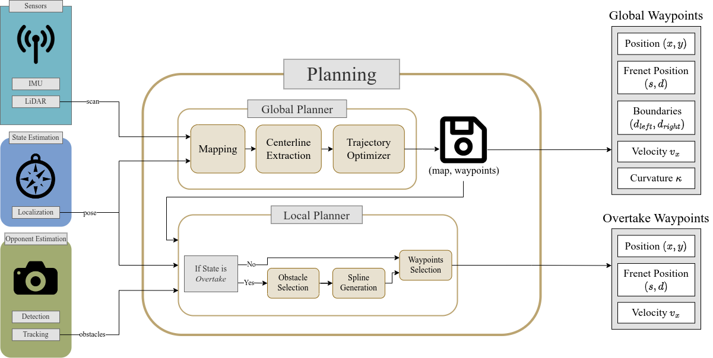

# Planner

Global planning (racing line generation) and local planning (overtaking, obstacle avoidance and recovery).

## Global Planner
- [`3d_gb_optimizer`](./3d_gb_optimizer/README.md): time-optimal racing line on 3D tracks (main pipeline of the 3D stack)
- [`2.5d_gb_optimizer`](./2.5d_gb_optimizer/README.md): minimum-curvature line with a slope-aware speed profile
- [`gb_optimizer`](./gb_optimizer/README.md): 2D minimum-curvature line

## Local Planner
- [`fast_sqp_planner`](./fast_sqp_planner/README.md): real-time avoidance path for overtaking and trailing
- [`sqp_planner`](./sqp_planner/README.md): SQP overtaking path using the GP opponent prediction
- [`spliner`](./spliner/README.md): spline avoidance, including static obstacle avoidance on 3D tracks
- [`recovery_spliner`](./recovery_spliner/README.md): path back to the racing line
